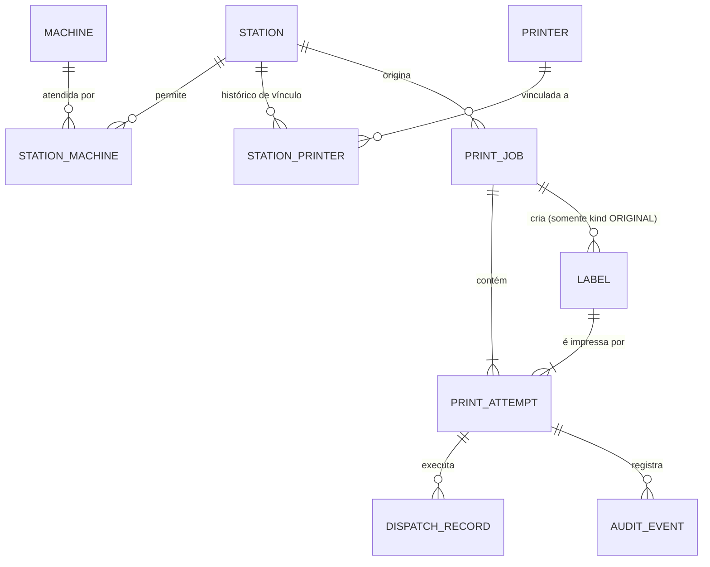
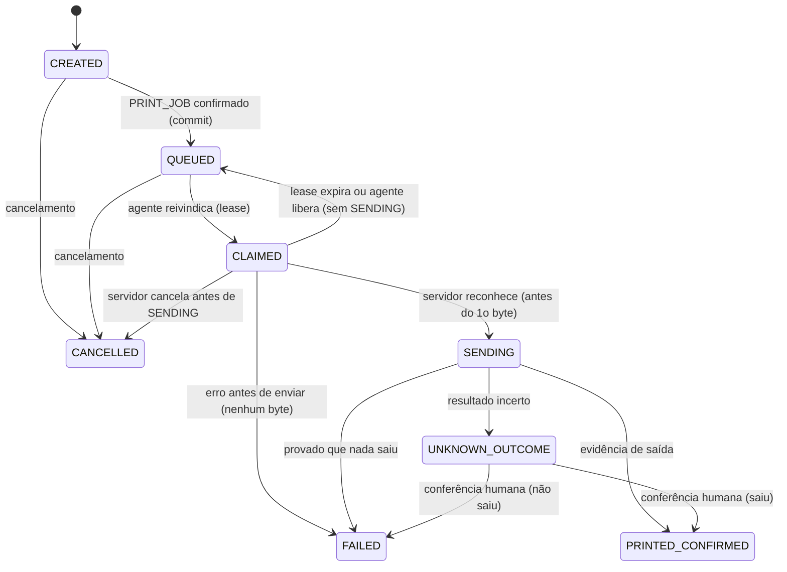

# Modelo de impressão — PRINT_JOB, LABEL e PRINT_ATTEMPT

> **Classificação:** SAFE_FOR_DOOWON
> **Status:** Rascunho v0.6 · **Data:** 2026-10-07 · **Substitui:** v0.2/v0.1
> **Modelo oficial (aprovado pela Clavia em 2026-10-06):** `PRINT_JOB → LABEL → PRINT_ATTEMPT`. Um PRINT_JOB `ORIGINAL` de quantidade N gera exatamente N LABELs. Validação com a Doowon pendente nos pontos marcados OPEN/RECOMMENDED.
> **Natureza:** documento de projeto, sem código. Nada aqui depende de modelo de impressora, protocolo, SO ou serviço AWS definidos. Onde a decisão é da Doowon, está marcado OPEN.
> **Limiares numéricos:** qualquer valor numérico citado é **PROPOSED — PENDING DOOWON VALIDATION** e não constitui compromisso.
> **Documento complementar:** `printing-reliability.md` (matriz de falhas, parâmetros, monitoramento e procedimentos).

## 1. Escopo e premissas

**Objetivo.** Garantir que cada etiqueta física corresponda a um registro rastreável, que nenhuma etiqueta seja duplicada por falha técnica e que nenhum estado "impresso" seja registrado sem evidência.

**Premissas de projeto (RECOMMENDED, pendentes de confirmação):**

- Existe um **Print Agent** local por estação que consulta a nuvem por HTTPS de saída (D-020).
- Sem rede ou sem AWS, **novas impressões rastreáveis falham fechado** (D-012).
- A fila de trabalho é o próprio banco (as tentativas de impressão são as linhas da fila), sem broker separado, para evitar escrita dupla.

**Princípio:** a impressão física não é transacional. Quando não é possível saber se a etiqueta saiu, o sistema assume **desconhecido** e exige decisão humana; nunca reenvia por conta própria.

## 2. Entidades: PRINT_JOB × LABEL × PRINT_ATTEMPT

Três conceitos distintos, que **não devem ser confundidos**:

| Entidade | O que é | Quantidade para um pedido de 32 etiquetas |
|---|---|---|
| `PRINT_JOB` | O **pedido** do operador (clicar em Imprimir 4, 8 ou 32). Tem chave de idempotência, quantidade, estação, máquina, impressora e operador. Seu estado é **derivado** dos estados das tentativas | **1** |
| `LABEL` | A **etiqueta lógica**: identificador único (`label_id`) e snapshot imutável dos dados. Existe independentemente de quantas vezes foi impressa | **32**, cada uma com `label_id` independente |
| `PRINT_ATTEMPT` | A **tentativa de produzir uma saída física** de uma LABEL dentro de um PRINT_JOB. É a unidade da máquina de estados. Na impressão original, `attempt_no = 1` | **30** (uma por LABEL) |

Entidades de apoio: `Station`, `Machine`, `Printer`, `DISPATCH_RECORD` (registro técnico de cada reivindicação/envio pelo agente) e `AuditEvent` (append-only).

**Regra central:** um pedido de 30 etiquetas gera **1 PRINT_JOB e 30 LABEL IDs independentes**. Nunca "1 job com 30 cópias da mesma etiqueta".

**Atenção ao termo "lote":** "Lote de produção" (exibido no protótipo) **não** é o PRINT_JOB. É um possível atributo de negócio cuja existência e origem a Doowon ainda não confirmou (D-039). Até a confirmação ele está **excluído** da etiqueta, do snapshot e dos fluxos confirmados (E-019). Neste documento, o pedido do operador é sempre PRINT_JOB; não se usa "lote" nem "batch" para ele.

**Reimpressão e nova tentativa:** PRINT_JOBs `REPRINT` e `RETRY` não criam LABELs novas: referenciam LABELs existentes e criam novos `PRINT_ATTEMPT` (D-011, RECOMMENDED: mesmo `label_id`).

### 2.1 Tipos de PRINT_JOB

| `kind` | Quando | Cria LABELs? | Exigências |
|---|---|---|---|
| `ORIGINAL` | Pedido normal do operador (4, 8 ou 32) | **Sim**: N LABELs novas | Idempotência, validações |
| `RETRY` | Etiqueta cuja última tentativa terminou em `FAILED` (provado que nada saiu) | Não | Ação humana; motivo opcional |
| `REPRINT` | Etiqueta física existe, mas foi danificada, perdida ou precisa de outra cópia | Não (mesmo `label_id`, RECOMMENDED, D-011) | Motivo, ator, autorização conforme D-019 |

`RETRY` e `REPRINT` podem cobrir uma ou mais LABELs existentes, criando para cada uma um novo `PRINT_ATTEMPT` com `attempt_no` seguinte.

### 2.2 Invariantes (todas testáveis)

| # | Invariante |
|---|---|
| INV-1 | Um PRINT_JOB `ORIGINAL` de quantidade N cria exatamente N LABELs e N PRINT_ATTEMPTs (`attempt_no = 1`) |
| INV-2 | Cada LABEL tem `label_id` único; não há duas LABELs com o mesmo `label_id` nem, se o QR contém o ID, o mesmo conteúdo de QR |
| INV-3 | Cada LABEL pertence a exatamente um PRINT_JOB `ORIGINAL` |
| INV-4 | Para qualquer PRINT_JOB, a soma das contagens de PRINT_ATTEMPT por estado é igual à quantidade de tentativas do job |
| INV-5 | Nenhum sistema (agente, API, reaper, rotina periódica) cria ou executa nova tentativa para uma LABEL cuja última tentativa esteja em `UNKNOWN_OUTCOME` |
| INV-6 | `UNKNOWN_OUTCOME` só sai desse estado por **resolução humana auditada** |
| INV-7 | O envio de bytes à impressora só ocorre após o servidor confirmar a transição para `SENDING` |
| INV-8 | No máximo uma tentativa em voo (`CLAIMED` ou `SENDING`) por impressora |
| INV-9 | Snapshots, tentativas e auditoria são somente inserção |
| INV-10 | O estado de um PRINT_JOB nunca é gravado à mão; é sempre calculado a partir das tentativas |

## 3. Estados do `PRINT_ATTEMPT`

| Estado | Significado | Terminal? |
|---|---|---|
| `CREATED` | Criada na transação do PRINT_JOB, ainda não elegível | Não |
| `QUEUED` | Elegível para o agente da estação/impressora. Pode estar retida (`hold_reason`) | Não |
| `CLAIMED` | Reservada por um agente com lease; **nenhum byte enviado** | Não |
| `SENDING` | O servidor reconheceu a transição; bytes podem ter sido enviados | Não |
| `PRINTED_CONFIRMED` | Saída física confirmada por evidência registrada | Sim |
| `FAILED` | **Provado** que nenhuma etiqueta física foi produzida por esta tentativa | Sim; permite um novo PRINT_JOB `RETRY` por ação humana |
| `UNKNOWN_OUTCOME` | Não se sabe se a etiqueta saiu | Não; exige resolução humana |
| `CANCELLED` | Cancelada antes de qualquer envio | Sim |

**"Não enviada"** não é um estado; é uma **categoria** derivada: tentativa que nunca chegou a `SENDING` (estados `CREATED`, `QUEUED` — retida ou não — ou `CLAIMED`) ou que foi `CANCELLED`.

**Evidência para `PRINTED_CONFIRMED`** (`evidence_type`): `PRINTER_ACK` (a impressora confirmou), `PRINTER_COUNTER` (contador de etiquetas consultado), `OPERATOR_CONFIRMATION` (uma pessoa conferiu a saída: o OPERATOR no fluxo normal de impressoras sem confirmação por software; o ADMIN na resolução de `UNKNOWN_OUTCOME`). Quais existem depende de D-007 (OPEN).

**Impressora sem confirmação.** Se a impressora não confirma, a tentativa permanece em `SENDING` com `sent_at` preenchido e a confirmação vem do operador. O tempo esgotado sem confirmação vai para `UNKNOWN_OUTCOME`, **nunca** para `PRINTED_CONFIRMED`. Ponto de ADR após D-007: avaliar um estado explícito "enviada, aguardando confirmação".

**Retenção (`hold_reason`).** Uma tentativa `QUEUED` pode estar retida (por falha ou incerteza anterior no mesmo PRINT_JOB, ou por impressora indisponível). O agente não reivindica tentativas retidas.

### 3.1 Estado derivado do PRINT_JOB

Prioridade de cima para baixo (a primeira regra que casar vale):

| Condição sobre as tentativas | Estado do PRINT_JOB |
|---|---|
| Alguma em `UNKNOWN_OUTCOME` | `REQUIRES_REVIEW` |
| Alguma em `FAILED` e ainda há tentativas não terminais retidas | `AWAITING_DECISION` |
| Alguma não terminal e não retida (`QUEUED`, `CLAIMED`, `SENDING`) | `IN_PROGRESS` |
| Todas `PRINTED_CONFIRMED` | `COMPLETED` |
| Todas terminais, ao menos uma `PRINTED_CONFIRMED` e ao menos uma `FAILED` ou `CANCELLED` | `PARTIALLY_COMPLETED` |
| Todas terminais, nenhuma `PRINTED_CONFIRMED`, ao menos uma `FAILED` | `FAILED` |
| Todas `CANCELLED` | `CANCELLED` |

## 4. Dados e snapshot imutável

### 4.1 Regra (E-002)

O evento de impressão (`PRINT_ATTEMPT`) preserva um **snapshot imutável, gravado por valor**, de todos os dados usados para gerar a etiqueta. Mudanças posteriores em peça, operador, máquina, turno, impressora ou modelo de etiqueta **não alteram** o histórico.

### 4.2 Onde o snapshot vive

| Registro | Conteúdo congelado | Quando é gravado |
|---|---|---|
| `LABEL.snapshot` | `label_id`, peça (id, descrição, Part Number), operador (id, nome exibido), máquina (id, código), estação (id), impressora (id), turno (id, nome), data/hora de produção (UTC e fuso usado), conteúdo do QR, `qr_schema_version`, `template_id` e `template_version`, `payload_hash` | Na criação do PRINT_JOB `ORIGINAL`, na mesma transação |
| `PRINT_ATTEMPT.render_snapshot` | Cópia **por valor** do snapshot da LABEL usado nesta tentativa, versão do modelo de etiqueta, perfil da impressora (DPI, linguagem, mídia), hash do comando renderizado | Na criação da tentativa |

Campos adicionais do `PRINT_ATTEMPT`: `attempt_no` (por LABEL), `print_job_id`, `label_id`, `state`, `version`, `hold_reason`, `evidence_type`, `failure_class`, `resolved_by`, `resolved_at`, `correlation_id`, `payload_hash`, `template_version`, `qr_schema_version`.

Campos do `DISPATCH_RECORD` (cada reivindicação/execução pelo agente): `agent_id`, `agent_version`, `claimed_at`, `send_acked_at`, `bytes_sent_at`, `result`, `printer_status_before/after`, `clock_skew_ms`, `correlation_id`.

### 4.3 Restrições

- O snapshot guarda **valores** (textos) além dos identificadores; não depende de joins a dados mestres mutáveis.
- Tabelas de snapshot, tentativas, registros de despacho e auditoria são **somente inserção**: o papel de banco da aplicação não tem permissão de alterar ou apagar esses registros (o resultado de uma tentativa é gravado uma única vez; a mudança de estado é um novo evento).
- `snapshot_hash` (hash do conteúdo canônico) permite detectar adulteração e comparar reimpressão com original.
- Dado pessoal do operador (nome) está no snapshot: retenção e anonimização dependem de D-023 (OPEN).
- Se a Doowon aceitar D-011 (mesmo ID), a reimpressão renderiza o **snapshot original**, não os dados mestres atuais. Se o modelo de etiqueta mudou desde o original, usar a versão original quando disponível (ponto de ADR).

### 4.4 Versionamento do modelo de etiqueta (E-008)

- Todo modelo de etiqueta tem `template_id` e `template_version` imutável: uma alteração de layout cria **nova versão**; versões usadas nunca são editadas.
- `LABEL.snapshot` e `PRINT_ATTEMPT.render_snapshot` gravam `template_id` e `template_version`. A reimpressão usa a versão original, se disponível.
- A aprovação visual de cada versão (quem aprova, registro) é **OPEN** (D-010).

### 4.5 Versionamento do schema do QR Code (D-036)

- O conteúdo do QR carrega uma **versão de schema** (`qr_schema_version`), gravada também no snapshot.
- Um leitor/consumidor deve conseguir identificar a versão e rejeitar com clareza uma versão que não conhece.
- Regras de compatibilidade (aditiva vs. quebra), quem consome o QR e política de convivência de versões: **OPEN** (D-036, depende de D-009).

### 4.6 `payload_hash` — integridade e reprodução (E-009)

- `payload_hash` é o hash do **payload canônico** da etiqueta (campos do snapshot + `qr_schema_version` + `template_version`, em serialização determinística).
- Gravado em `LABEL` e em cada `PRINT_ATTEMPT`. Permite (a) detectar adulteração, (b) provar que a reimpressão usou o mesmo conteúdo do original e (c) reproduzir a etiqueta a partir do snapshot.
- Complementa `snapshot_hash` (§4.3) e o hash do comando renderizado.
- Algoritmo e formato de serialização: ADR.

### 4.7 `correlation_id` ponta a ponta (E-010)

- Um `correlation_id` é gerado no pedido do navegador e propagado por API, PRINT_JOB, LABEL, PRINT_ATTEMPT, `DISPATCH_RECORD`, Print Agent, eventos de auditoria e logs; também é devolvido ao operador na mensagem de erro (código curto).
- Toda requisição do agente ao backend carrega o `correlation_id` da tentativa.
- Permite reconstruir uma ocorrência sem pedir ao operador detalhes técnicos.

### 4.8 Auditoria append-only (E-013)

- Eventos de auditoria, snapshots, tentativas e registros de despacho são **somente inserção** (INV-9). Correções são **novos eventos** que referenciam o anterior; nunca `UPDATE`/`DELETE` pela aplicação.
- Cada evento registra ator, estação, horário (servidor), `correlation_id`, ação, alvo e resultado.
- Verificação de integridade (por exemplo, encadeamento de hashes) é opção a decidir em ADR.

### 4.9 Inativação em vez de exclusão de dados mestres (E-014)

- Máquina, operador, peça/modelo, turno, impressora e estação **com histórico associado** não são excluídos: são **inativados** (`active=false`, com ator e data).
- Registro inativado deixa de aparecer para novas seleções, mas continua legível no histórico.
- Exclusão física só para registros **sem histórico** (por exemplo, criado por engano), e auditada.
- Retenção e anonimização de dado pessoal continuam sujeitas a D-023.

## 5. Transições, reconhecimento antes do envio e resultado desconhecido

### 5.1 Tabela de transições (por `PRINT_ATTEMPT`)

| De → Para | Gatilho | Quem | Guarda (condição) | Efeitos / auditoria |
|---|---|---|---|---|
| `[*]` → `CREATED` | PRINT_JOB aceito | Servidor | Idempotência e validações passaram | Cria o PRINT_JOB, N LABELs e N tentativas, N eventos |
| `CREATED` → `QUEUED` | Commit do PRINT_JOB | Servidor | Transação completa | Disponibiliza ao agente |
| `QUEUED` → `CLAIMED` | Agente reivindica | Agente | Tentativa é da estação/impressora do agente; não retida; é a próxima da ordem; nenhuma outra em voo nessa impressora | Define dono e validade do lease |
| `CLAIMED` → `QUEUED` | Lease expirou ou o agente liberou | Servidor / agente | Nenhum reconhecimento de SENDING | Seguro: nada foi enviado |
| `CLAIMED` → `SENDING` | **Reconhecimento do servidor** | Servidor, a pedido do agente | Atualização condicional: estado = CLAIMED, mesmo dono, lease válido, tentativa não cancelada | Só após o `ack` o agente pode enviar o 1º byte |
| `CLAIMED` → `FAILED` | Erro antes de enviar (ex.: modelo inválido) | Agente | `evidence = NO_BYTES_SENT` | Classe de falha registrada |
| `SENDING` → `PRINTED_CONFIRMED` | Evidência de saída | Agente / operador | Evidência registrada | `evidence_type` obrigatório |
| `SENDING` → `FAILED` | Falha provada sem saída | Agente | Falha reportada antes de qualquer byte **ou** rejeição pela impressora certificada pelo adaptador como sem saída | `failure_class` obrigatório |
| `SENDING` → `UNKNOWN_OUTCOME` | Queda de conexão, timeout, perda de lease, falha do agente ou reinício | Agente / servidor | Qualquer incerteza | Alerta ao operador; retenção das demais tentativas do PRINT_JOB |
| `UNKNOWN_OUTCOME` → `PRINTED_CONFIRMED` | ADMIN confirma que a etiqueta saiu | Humano | Somente `ADMIN` (RECOMMENDED, a validar — D-031); observação | Evidência `OPERATOR_CONFIRMATION` |
| `UNKNOWN_OUTCOME` → `FAILED` | ADMIN confirma que a etiqueta **não** saiu | Humano | Somente `ADMIN` (RECOMMENDED, a validar — D-031) | Só então é permitido um novo PRINT_JOB `RETRY` para essa LABEL |
| `CREATED/QUEUED/CLAIMED` → `CANCELLED` | Cancelamento | Operador ou servidor | Nenhum reconhecimento de SENDING | O reconhecimento falha se a tentativa foi cancelada |

### 5.2 Reconhecimento antes do primeiro byte (E-004)

1. O agente reivindica a tentativa (lease).
2. Renderiza o comando de impressão localmente. Erros aqui terminam em `FAILED` (nenhum byte enviado).
3. Antes de enviar, grava no **journal local** (durável) a intenção e pede ao servidor a transição para `SENDING`.
4. **Sem `ack` do servidor, o agente não envia nada.** Isso é falha fechada: a perda de rede nesse ponto não produz etiqueta.
5. Com o `ack`, grava no journal "ack recebido", depois "prestes a enviar", transmite os bytes e reporta o resultado. A ordem das entradas permite provar, após uma falha, se algum byte pode ter sido enviado.

Consequência: toda etiqueta que pode ter saído fisicamente tem uma tentativa em `SENDING` ou posterior. Não existe etiqueta física sem registro prévio.

## 6. Idempotência, clique duplicado e pedidos de 4, 8 e 32

### 6.1 Chave de idempotência (E-001)

- O cliente gera a chave quando a tela entra no estado "confirmar impressão" e a **reutiliza** até conhecer o resultado do pedido (não é gerada a cada clique).
- O servidor guarda a chave com a **assinatura do pedido** (peça, quantidade, máquina, estação, impressora, operador).
- **Mesma chave e mesma assinatura:** devolve o PRINT_JOB já criado (mesmo `print_job_id`), sem criar nada novo.
- **Mesma chave e assinatura diferente:** rejeita com erro de conflito.
- A criação do PRINT_JOB, das LABELs e das tentativas ocorre em **uma única transação**; a restrição de unicidade da chave no banco é a barreira final.
- A chave é retida pelo menos enquanto o PRINT_JOB existir.
- Pedidos `RETRY` e `REPRINT` têm chave de idempotência própria.

### 6.2 Clique duplicado

| Camada | Proteção |
|---|---|
| Interface | Desabilita o botão imediatamente; mostra "Enviando…" |
| Cliente | Reutiliza a mesma chave durante o pedido |
| API | Idempotência por chave (acima) |
| Banco | Restrição de unicidade da chave |
| Concorrência | **No máximo um PRINT_JOB ativo por impressora** (E-005, regra da V1; a impressora é dedicada ao posto): um segundo pedido com **outra chave** para a impressora do mesmo posto é bloqueado com "Impressora em uso", sem criar PRINT_JOB |

O último caso cobre o duplo clique que gera duas chaves diferentes. É regra da V1 (§6.4).

**Recarregar a página durante a impressão:** a interface consulta o PRINT_JOB ativo da estação no servidor; não reenvia o pedido.

### 6.3 Pedidos de 4, 8 e 32

- A quantidade só pode ser **4, 8 ou 32**, validada no servidor.
- Cada pedido cria **1 PRINT_JOB**, **N LABELs** (cada uma com `label_id` independente e `sequence_in_job`) e **N PRINT_ATTEMPTs**.
- As tentativas são enviadas **uma por vez**, na ordem do PRINT_JOB, por impressora.

| Pedido | PRINT_JOB | LABEL IDs | PRINT_ATTEMPTs | Sucesso parcial possível? |
|---|---|---|---|---|
| Imprimir 1 | 1 | 1 | 1 | Não |
| Imprimir 10 | 1 | 10 independentes | 10 | Sim |
| Imprimir 30 | 1 | 30 independentes | 30 | Sim |

### 6.4 Concorrência por impressora (regra da V1; D-037 fechada)

- **Regra da V1 (E-005; D-037 fechada em 2026-10-07):** somente **um PRINT_JOB ativo por impressora**, e a impressora é a do posto. "Ativo" = não terminal (`IN_PROGRESS`, `AWAITING_DECISION` ou `REQUIRES_REVIEW`). Enquanto houver um PRINT_JOB ativo para a impressora do posto, **novos comandos de impressão são bloqueados** com a mensagem **"Impressora em uso"**, **antes de criar** PRINT_JOB, LABEL ou PRINT_ATTEMPT. A verificação é feita **no servidor**, de forma atômica com a criação (sem janela de corrida entre dois pedidos simultâneos); o bloqueio na interface é apenas complementar. O bloqueio é registrado em log/auditoria (evento de rejeição com `correlation_id`, posto e operador), que **não** é um PRINT_JOB. Reenvio com a **mesma** chave de idempotência e a mesma assinatura não é um novo comando: devolve o PRINT_JOB existente (§6.1). Não há fila.
- INV-8 continua valendo: no máximo uma tentativa em voo por impressora.
- **Cada posto tem impressora dedicada** (D-018): Posto 01 → Print Agent 01 → Impressora 01; Posto 02 → Print Agent 02 → Impressora 02. Não há compartilhamento, logo não existe concorrência entre postos pela mesma impressora. Um bloqueio em um posto **não** afeta o outro.
- A regra é aplicada **no servidor** e a ordem de envio dentro de uma impressora é determinística e auditável.
- Fila, impressora compartilhada entre postos e prioridade **não fazem parte da V1**; qualquer pedido nesse sentido segue o procedimento de mudança de escopo.

### 6.5 Sessão e troca de operador (D-038)

- **Base (RECOMMENDED):** cada PRINT_JOB e cada LABEL registram o operador **autenticado no momento do pedido**; o snapshot grava esse operador. Nunca se herda o operador de sessão anterior.
- **Pontos em aberto (D-038):** o PC é compartilhado entre turnos? Como o operador se identifica (usuário/senha, crachá, PIN)? Tempo de inatividade até bloquear a sessão? Troca de operador com PRINT_JOB em andamento: bloquear a troca ou permitir? O PRINT_JOB em andamento continua atribuído a quem o pediu? Como a troca de turno interage com sessão aberta?
- Princípio de segurança (RECOMMENDED): troca de operador **não** altera a atribuição de PRINT_JOBs já criados, e a tela mostra sempre o operador, a máquina e o turno ativos antes de imprimir.

## 7. Vínculo posto → Print Agent → impressora (e máquina)

**Estado:** D-018 **RESOLVED** (2026-10-07): Posto 01 → Print Agent 01 → Impressora 01 e Posto 02 → Print Agent 02 → Impressora 02; impressora dedicada, não compartilhada, e configuração técnica do posto. Origem: informação repassada pela Clavia em 07/10/2026, aguardando identificação da fonte Doowon para evidência formal. O vínculo **posto → máquina** segue OPEN (D-040; recomendação da Clavia: fixo 1:1, Posto 01 → Máquina 01 e Posto 02 → Máquina 02, o que elimina a escolha manual); o modelo abaixo atende aos dois cenários e não assume qual vale.

| Cenário | Como o modelo representa |
|---|---|
| A. Cada estação atende uma única máquina | A tabela de máquinas permitidas da estação tem uma linha |
| B. O operador escolhe entre várias máquinas na estação | A tabela tem várias linhas e a escolha é validada |

Regras (E-006):

- O navegador envia a **máquina escolhida**; o servidor valida que ela está entre as permitidas para a estação autenticada. A **impressora é derivada no servidor** a partir da estação; o cliente nunca informa a impressora.
- O agente autenticado só enxerga tentativas da **sua** estação e da **sua** impressora.
- Vínculos têm histórico de validade (início/fim). A troca de impressora ou máquina é ação administrativa, auditada.
- O snapshot de cada LABEL registra estação, máquina e impressora vigentes.
- **Configuração técnica (E-022):** vínculos e parâmetros da impressora são definidos na implantação pela Clavia/Doowon TI; não há CRUD de impressora para o ADMIN na V1; mudanças são registradas.
- **Visibilidade (E-023):** o OPERATOR vê o status apenas da impressora do próprio posto; o ADMIN vê as duas. A regra é aplicada no servidor.
- Mudar o vínculo com PRINT_JOBs não terminais é bloqueado.

## 8. Identidade e autenticação do Print Agent

**Estado:** D-027 RECOMMENDED; escolha final depende de C12, C13 e D-006.

1. **Uma identidade por estação**, única e revogável. Nunca compartilhada.
2. **Inscrição em duas etapas:** token de inscrição de uso único e validade curta, gerado por administrador; o agente o troca por credencial própria.
3. **Credencial protegida:** certificado de cliente (mTLS) ou token assinado de curta duração, guardada no cofre protegido do SO (se disponível).
4. **Vínculo no servidor:** credencial → `station_id` → `printer_id`. O agente não escolhe a impressora.
5. **Chamadas que mudam estado** (reivindicar, SENDING, resultado, liberação) são autenticadas e protegidas contra repetição.
6. **Revogação** com efeito rápido; credencial revogada não consegue reivindicar tentativas.
7. **Rotação** periódica, sem parada de produção.
8. **Escopo mínimo:** o agente não acessa APIs de usuário nem dados de outras estações.
9. **Sem credenciais de operador** no agente: a tentativa carrega o snapshot necessário.
10. **Auditoria:** inscrição, rotação, revogação e falhas de autenticação são registradas.
11. **Telemetria autenticada:** versão, desvio de relógio e status da impressora vêm em cada contato.
12. **Segredos fora do repositório e do instalador.**

### 8.1 Heartbeat e versão do agente (E-011)

- O agente envia **heartbeat** periódico autenticado (valores em `printing-reliability.md` §3, `PROPOSED — PENDING DOOWON VALIDATION`), também durante `SENDING`.
- Cada contato informa `agent_version`, `protocol_version`, desvio de relógio, status da impressora e `station_id` (derivado da credencial).
- O servidor mantém, por estação, o último heartbeat e a versão; ausência de heartbeat gera alerta e impede novas reivindicações.

### 8.2 Compatibilidade Agent ↔ Backend (E-012)

- O backend publica **versão mínima e máxima suportadas** do agente (`protocol_version`).
- Agente fora da faixa **não reivindica** tentativas: recebe recusa explícita e gera alerta; nada é enviado à impressora.
- Mudanças de contrato seguem expandir/contrair: o backend aceita a versão atual e a anterior do agente durante a janela de atualização.
- Teste de compatibilidade (versão atual e anterior) é parte do CI do agente e do backend.

### 8.3 Atualização e rollback controlados do agente (E-015)

- Atualização **não ocorre com PRINT_JOB ativo** na estação: é adiada até não haver tentativa em voo nem `UNKNOWN_OUTCOME` aberto.
- A versão nova é **verificada** (assinatura, quando exigida — D-029) antes de ser ativada; a versão anterior permanece disponível localmente.
- Se o agente novo não enviar heartbeat saudável após a ativação, o procedimento define **rollback para a versão anterior**; o rollback é ensaiado nas duas estações antes do go-live.
- Janela, autorização e mecanismo de distribuição (instalação manual, ferramenta corporativa ou atualização puxada): **OPEN** (D-028, D-032).
- Cada atualização e rollback é auditado (estação, versão origem/destino, ator, resultado).

## 9. Política de retry e resultado desconhecido (E-003)

**Regra absoluta:** uma LABEL cuja última tentativa está em `UNKNOWN_OUTCOME` **não pode ser reimpressa nem tentada novamente por nenhum mecanismo automático** (INV-5, INV-6).

| Situação | Retry automático? | Observação |
|---|---|---|
| Falha ao reivindicar (rede, API) | Sim, com espera crescente | Nada foi enviado |
| Lease expirou em `CLAIMED` | Sim: volta a `QUEUED` | Nada foi enviado |
| Falha de renderização | Não repete cegamente | `FAILED`; corrigir causa |
| Impressora indisponível antes do envio | Aguarda (tentativa fica `QUEUED` com retenção) | Nada foi enviado |
| **Qualquer incerteza após o `ack` de SENDING** | **Não, nunca** | `UNKNOWN_OUTCOME` |
| Falha ao **reportar** resultado ao servidor | Sim (repete o relatório, idempotente) | Reportar não reimprime |
| `FAILED` provado | Não automático | Novo PRINT_JOB `RETRY` por ação humana |

**Resolução de `UNKNOWN_OUTCOME` (única saída):** conferência física **por um ADMIN** (RECOMMENDED, a validar com a Doowon — D-031).

| Papel | Pode |
|---|---|
| `OPERATOR` | **Ver** o estado `UNKNOWN_OUTCOME`, ver quais etiquetas estão confirmadas/incertas/não enviadas, e **solicitar ação** (registra `RESOLUTION_REQUESTED` com `correlation_id`, estação e horário; notifica o ADMIN). **Não** resolve. |
| `ADMIN` | Conferir fisicamente e resolver; decidir continuar/cancelar as retidas; criar PRINT_JOB `RETRY` quando cabível |

1. O ADMIN verifica a impressora e a saída física.
2. Marca **"a etiqueta saiu"** (`PRINTED_CONFIRMED`, evidência `OPERATOR_CONFIRMATION`) ou **"não saiu"** (`FAILED`). (O nome da evidência é histórico: refere-se à conferência humana, feita pelo ADMIN.)
3. Observação e responsável registrados em auditoria (append-only).
4. Só após "não saiu" é permitido um PRINT_JOB `RETRY`; ele é criado por ação humana.

**Autorização no servidor:** a API rejeita a resolução por `OPERATOR` (nunca apenas ocultar o botão).

**Consequência operacional (a validar):** com `UNKNOWN_OUTCOME` aberto, a impressora fica **bloqueada** para novos pedidos (RECOMMENDED, mais seguro). Se não houver ADMIN disponível no turno, a produção naquela impressora aguarda. Disponibilidade de ADMIN em todos os turnos, ou uma alternativa aprovada pela Doowon, é **OPEN** (D-031). Não será criado um terceiro perfil sem decisão da Doowon (D-019).

## 10. Sucesso parcial de um PRINT_JOB (D-031)

Quando uma tentativa de um PRINT_JOB não termina em `PRINTED_CONFIRMED`, as demais tentativas ainda não enviadas ficam **retidas** (`hold_reason = JOB_HELD`) e **nada é enviado automaticamente**. O operador vê, por etiqueta, o estado: confirmada, falhou, desconhecida, não enviada.

### 10.1 Caso de referência: 17 confirmadas, 1 desconhecida, 12 não enviadas

Pedido: **Imprimir 30**. Resultado após a interrupção:

| Elemento | Quantidade e detalhe |
|---|---|
| PRINT_JOB | **1** (`ORIGINAL`), estado derivado `REQUIRES_REVIEW` |
| LABEL IDs | **30**, independentes (L01 a L30) |
| PRINT_ATTEMPTs | **30** (`attempt_no = 1`) |
| L01–L17 | 17 × `PRINTED_CONFIRMED` |
| L18 | 1 × `UNKNOWN_OUTCOME` |
| L19–L30 | 12 × `QUEUED` com `hold_reason = JOB_HELD` (categoria "não enviadas") |
| Verificação (INV-4) | 17 + 1 + 12 = **30** |

**O que o sistema faz e não faz:**

- Não reenvia L18 (INV-5) nem libera L19–L30 automaticamente.
- Bloqueia novos PRINT_JOBs na mesma impressora (RECOMMENDED) e impede reimpressão de L18 até a resolução.
- Alerta o operador e registra evento de auditoria.

**Decisões do operador e resultado final** (cada ação é auditada com ator, estação e horário):

| Resolução de L18 | Restante (L19–L30) | L18 | L19–L30 | Estado final do PRINT_JOB |
|---|---|---|---|---|
| "Saiu" | Continuar | `PRINTED_CONFIRMED` | 12 × `PRINTED_CONFIRMED` | `COMPLETED` (30 confirmadas) |
| "Saiu" | Cancelar | `PRINTED_CONFIRMED` | 12 × `CANCELLED` | `PARTIALLY_COMPLETED` (18 confirmadas, 12 canceladas) |
| "Não saiu" | Continuar | `FAILED` | 12 × `PRINTED_CONFIRMED` | `PARTIALLY_COMPLETED` (29 confirmadas, 1 falha); faltando a etiqueta L18: PRINT_JOB `RETRY` por ação humana (nova tentativa, `attempt_no = 2`) |
| "Não saiu" | Cancelar | `FAILED` | 12 × `CANCELLED` | `PARTIALLY_COMPLETED` (17 confirmadas, 1 falha, 12 canceladas); L18 pode receber `RETRY` por ação humana |

Observações:

- Liberar as retidas (continuar) só é permitido depois que L18 for resolvida (RECOMMENDED).
- A LABEL L18 mantém seu `label_id` em todos os cenários; o histórico mostra todas as tentativas.
- A resolução de L18 é feita por **ADMIN** (RECOMMENDED). O OPERATOR vê o estado e solicita ação, sem resolver. Se a Doowon decidir outro responsável (por exemplo, supervisor), isso exige novo perfil (D-019) e muda a tabela de permissões.

### 10.2 Outros cenários (PRINT_JOB de 30)

| Cenário | Resultado esperado |
|---|---|
| Falha **provada** na etiqueta 17 | 1–16 confirmadas; 17 `FAILED`; 18–30 retidas; PRINT_JOB `AWAITING_DECISION` |
| Impressora sem mídia no início | Nenhuma tentativa chega a `SENDING`; todas permanecem `QUEUED` com aviso; após reabastecer, o agente retoma |
| Cancelamento durante o PRINT_JOB | Tentativas `QUEUED/CLAIMED` viram `CANCELLED`; a tentativa em voo segue as regras de `SENDING` |

## 11. Reimpressão auditável

- Reimpressão cria **novo PRINT_JOB `REPRINT`** que referencia LABEL(s) existente(s) e cria novas tentativas com `attempt_no` seguinte, no **mesmo `label_id`** (RECOMMENDED, D-011).
- **Exige**: motivo (lista a definir, D-019), ator, estação, data/hora e chave de idempotência própria.
- Os registros anteriores **não são alterados nem apagados**.
- Reimpressão usa o **snapshot original** (seção 4.3).
- Não é permitido reimprimir etiqueta com tentativa em `UNKNOWN_OUTCOME` sem antes resolver o desconhecido.
- Quem pode autorizar e se a etiqueta reimpressa deve ser distinguível: OPEN (D-019, D-010).
- Se a Doowon decidir por novo ID na reimpressão, isso muda a semântica de rastreabilidade e exige novo ADR.

## 12. Comportamento durante perda de rede

Princípio: falhar fechado para novas impressões; nunca imprimir sem registro prévio no servidor.

| Onde falha | Estado das tentativas | O que acontece |
|---|---|---|
| Navegador ↔ API antes do pedido ser aceito | Nenhuma criada | Nada é criado nem impresso; a interface avisa e permite tentar de novo com a mesma chave |
| Navegador ↔ API depois do pedido aceito | Seguem normalmente | A interface recupera o PRINT_JOB ativo da estação ao reconectar |
| Agente ↔ API com tentativas `QUEUED` | `QUEUED` | Esperam; a interface mostra "aguardando a estação"; o operador pode cancelar |
| Agente ↔ API em `CLAIMED`, antes do `ack` | `CLAIMED` → `QUEUED` | O agente **não envia** (sem `ack`) |
| Perda após o `ack` de `SENDING` | `SENDING` | O agente termina ou aborta e guarda o resultado no journal; reporta ao reconectar; sem certeza: `UNKNOWN_OUTCOME` |
| Perda durante o envio dos bytes | `SENDING` → `UNKNOWN_OUTCOME` | Sem retry automático |
| AWS inteira indisponível | Nenhuma nova | A operação aguarda; sem geração local de IDs nem fila offline (D-012) |

**Reportar resultados** pode ser repetido (operação idempotente). Isso é diferente de reenviar o comando à impressora, que nunca é automático após incerteza.

## 13. Recuperação após reinício da estação

O agente mantém um **journal local durável** com: tentativa reivindicada, `ack` de SENDING recebido, "prestes a enviar", envio concluído, resultado pendente de reporte.

No início, o agente lê o journal e aplica:

| Última entrada do journal | Ação | Resultado no servidor |
|---|---|---|
| `CLAIMED`, sem `ack` | Libera a tentativa | `CLAIMED → QUEUED`; nada foi enviado |
| `ack` recebido, sem a entrada "prestes a enviar" | Prova de que nenhum byte foi enviado; não reenvia sozinho; reporta `NO_BYTES_SENT` | `SENDING → FAILED`; novo PRINT_JOB `RETRY` só por ação humana |
| "Prestes a enviar", envio iniciado ou concluído, sem resultado | **Não reenvia**; consulta a impressora se possível; reporta evidência | `UNKNOWN_OUTCOME` (ou `PRINTED_CONFIRMED` com evidência) |
| Resultado pendente de reporte | Reporta (idempotente) | Estado final registrado |
| Journal ausente ou corrompido | Reporta "journal indisponível" | O servidor marca as tentativas `SENDING` da estação como `UNKNOWN_OUTCOME` |

**Do lado do servidor:** um processo periódico (reaper) examina leases expirados. `CLAIMED` expirado volta a `QUEUED`; `SENDING` com lease expirado vira `UNKNOWN_OUTCOME`. O processo é idempotente e sobrevive a reinício do servidor. **O reaper nunca cria tentativa nova** (INV-5).

**Outros casos:**

- **PC reinicia no meio de um PRINT_JOB:** o job fica `REQUIRES_REVIEW` se houver tentativa em `SENDING`; a interface recupera o estado do servidor ao abrir.
- **Impressora desligada/religada:** pode haver conteúdo na fila interna ou etiqueta parcial. Tentativas em `SENDING` ficam `UNKNOWN_OUTCOME`; o procedimento operacional manda conferir e limpar a impressora (runbook a criar). O agente não limpa a impressora sozinho.

## 14. Mensagens ao operador (português simples)

| Situação | Mensagem sugerida |
|---|---|
| Impressora indisponível | "Impressora indisponível. Verifique o equipamento e tente novamente." |
| Resultado desconhecido | "Não foi possível confirmar a impressão. Não imprima novamente até verificar a etiqueta." |
| Solicitação ao administrador | "Aviso enviado ao administrador. Aguarde a conferência da etiqueta." |
| Impressora com PRINT_JOB ativo (bloqueio da V1, E-005) | "Impressora em uso" |
| Pedido com retenção | "A impressão parou na etiqueta [N] de [TOTAL]. Chame o administrador para conferir e decidir." (o administrador vê: continuar, cancelar o restante ou conferir) |
| Sem rede | "Sem conexão com o sistema. A impressão não foi iniciada." |
| Sessão expirada | "Sua sessão expirou. Entre novamente para continuar." |

Sem termos técnicos, sem pilha de erro. O identificador de correlação fica no registro para suporte.

## 15. Pontos em aberto que afetam este modelo

| Ponto | Decisão |
|---|---|
| A impressora confirma saída por software? Quais evidências existem? | D-007 |
| Estado explícito "enviada, aguardando confirmação" | ADR após D-007 |
| Vínculo posto ↔ máquina (fixo 1:1 ou escolha) | D-040 |
| Validar com a Doowon: ADMIN resolve `UNKNOWN_OUTCOME`; OPERATOR só vê e solicita; bloqueio da impressora; disponibilidade de ADMIN por turno | D-031 |
| Versionamento do schema do QR | D-036 |
| Vínculo posto → impressora | D-018 — **RESOLVED** (impressora dedicada); D-037 **fechada** para a V1 |
| Sessão e troca de operador | D-038 |
| Distribuição, janela e rollback do agente | D-028, D-032 |
| Quem autoriza reimpressão; motivos; etiqueta distinguível | D-019, D-010 |
| Mesmo ID na reimpressão | D-011 |
| Comportamento sem rede | D-012 |
| Hora impressa: do pedido ou da impressão | D-010, D-030 |
| Retenção e anonimização do nome do operador no snapshot | D-023 |
| Mecanismo de credencial do agente | D-027 |
| Gates A, B e C (homologação física antes do go-live) | D-035 |
